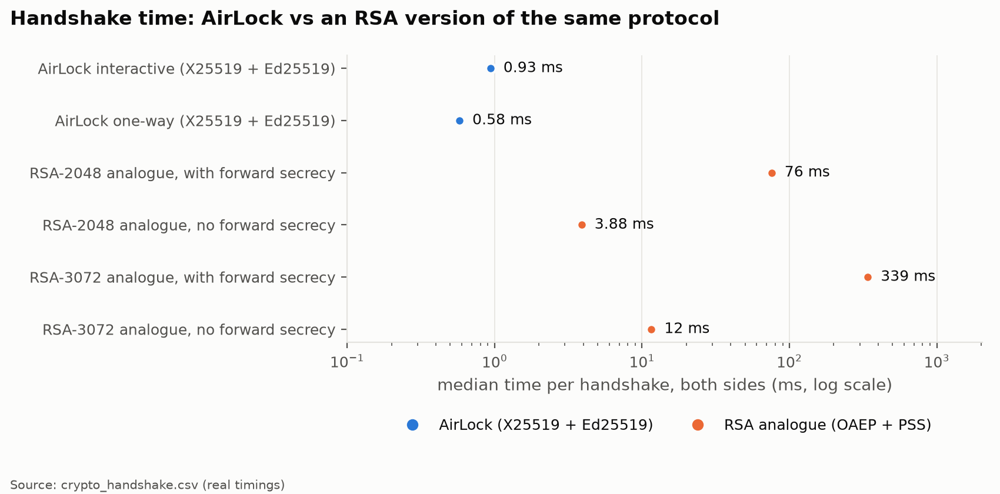
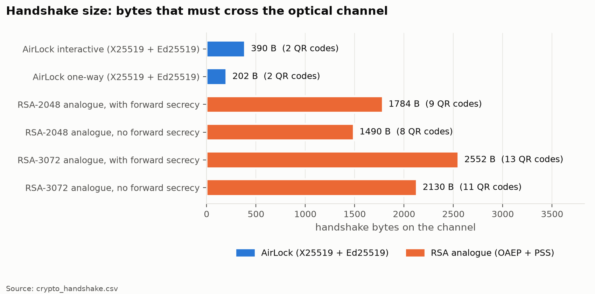
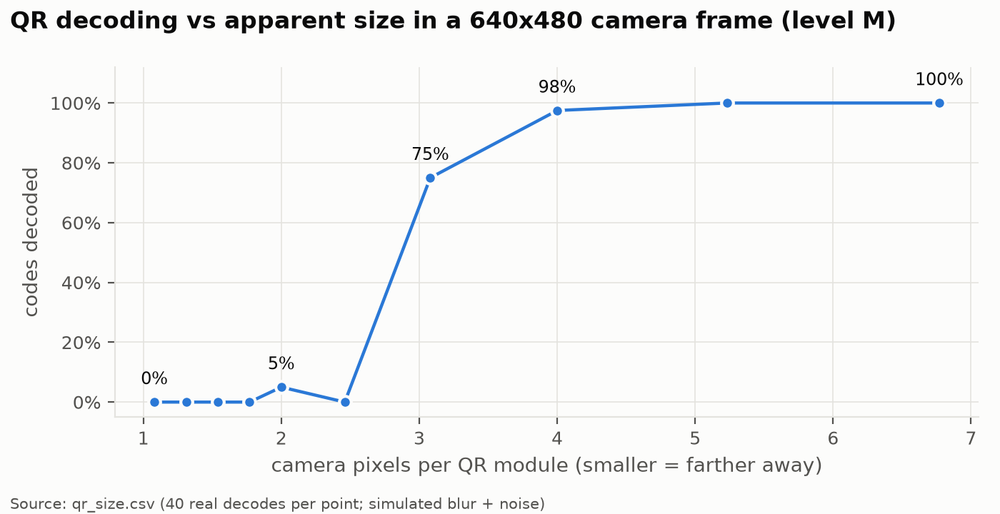
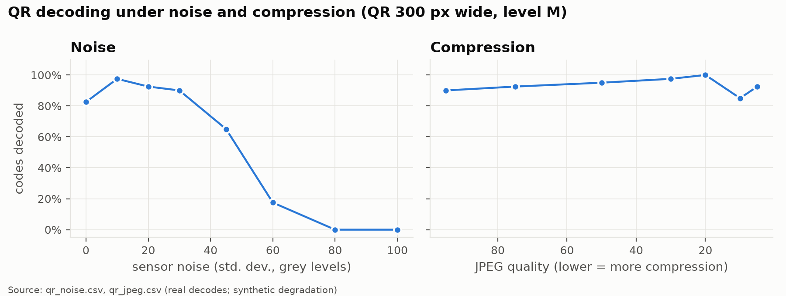
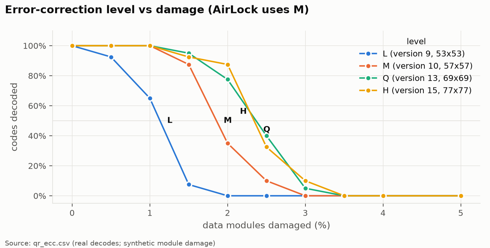
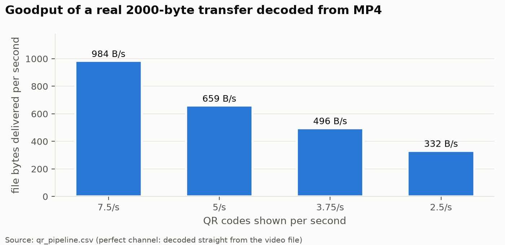

# AirLock: Threat-Modelled Secure File Transfer over Air-Gapped Optical Channels

**Course:** Information Security, semester project
**Author:** *[your name, student ID]*
**Date:** *[submission date]*
**Code:** this repository. Every figure and number below can be regenerated from it (Appendix A).

> **Draft status.** Sections 1–8 are complete. Before submission:
> 1. fill in the bracketed *[ ]* fields;
> 2. verify each related-work entry yourself (§2; the notes say what was and was not confirmed);
> 3. run the live phone-to-webcam benchmark (§6.5) and replace that section's placeholder sentence with the measured numbers.

---

## Abstract

Moving a file between two devices that share no network connection is a
common requirement in high-security settings. Optical and acoustic
channels such as animated QR codes and data-over-sound make this possible,
but many tools built on them treat the channel as private, when anyone
with a camera or microphone can observe and inject into it. This project
presents **AirLock**, a file-transfer system in which every channel is
treated as fully attacker-controlled, and security comes from a single
threat-modelled cryptographic protocol. AirLock combines Ed25519 identity
keys pinned after an in-person fingerprint check, an X25519 key exchange
with transcript-bound signatures (SIGMA-style), HKDF-SHA256 key derivation,
AES-256-GCM authenticated encryption with the packet header as associated
data, a signed file manifest, and a fail-closed receiver that writes
nothing to disk until the whole file has been verified.

Two handshake modes are provided:
- an **interactive** mode with forward secrecy on both sides, for channels
  that work in both directions;
- a **one-way** mode for screen-to-camera transfer, where the receiving
  device can never answer. It trades away forward secrecy against
  compromise of the receiver's key, and replaces fresh receiver randomness
  with signed timestamps and a persistent replay store.

The prototype (Python, about 5,000 lines plus 1,700 lines of tests) sends
files as looping QR-code videos played on a phone and read by a laptop
webcam. Six scripted attack demonstrations show it resisting
eavesdropping, man-in-the-middle, replay, tampering and truncation. The
same man-in-the-middle attack is shown succeeding against a deliberately
unauthenticated variant.

Measured on the development laptop:
- AirLock's handshake takes **0.93 ms** and **390 bytes**, against
  **339 ms** and **2,552 bytes** for an RSA-3072 analogue with forward
  secrecy;
- the QR channel delivers about **500 B/s** of file data under ideal
  conditions;
- decoding becomes reliable at about **4 camera pixels per QR module**.

The system has been tested against these attacks. It has not been proven
secure.

---

## 1. Introduction

### 1.1 Motivation

Air-gapped systems are isolated from networks on purpose: industrial
controllers, voting machines, signing servers and secure research
workstations. Data still has to move on and off them occasionally. USB
drives are the usual answer, and they are also a well-known malware
vector. Channels made of *light and sound* are an alternative: a screen
shows data and a camera reads it, or a speaker plays tones that a
microphone records. These channels need no shared hardware and carry no
executable media.

Their weakness is that they are **broadcast media**. Anyone in the room,
or anyone with a telephoto lens or a sensitive microphone, can record
them, and anyone with a screen or a speaker can inject into them. A
security design that relies on "only the intended camera can see the
screen" is not a security design. The academic literature on air-gap
*exfiltration* shows how capable such observers are: Guri et al.'s series
of papers leaks data through screen brightness, LEDs and acoustic
emanations *[verify the specific citations you use]*.

### 1.2 Goal

Build a transfer system whose security **does not depend on the channel
at all**. The cryptographic protocol is written once. Each physical
channel only has to implement `send(bytes)` and `receive() -> bytes`, and
is assumed to be fully controlled by the adversary.

### 1.3 Contributions

1. A threat model (STRIDE, 20 threats) in which every threat is mapped to
   a defence *and* to the test or demo that checks it (§3).
2. A protocol with two handshake modes that share one data phase (§4).
   The one-way mode makes a phone usable as a sender that runs no code at
   all.
3. A working prototype with an animated-QR transport, a command-line tool
   and 143 automated tests (§5).
4. Six reproducible attack demonstrations, including a deliberately
   insecure baseline that shows *why* authentication is needed (§6.1).
5. Measured benchmarks: elliptic curves against RSA, the robustness of
   the QR channel, and end-to-end goodput (§6.2–6.4).

---

## 2. Related Work

> Each entry was checked with a web search while this draft was written.
> The descriptions are summaries of the projects' **own** documentation.
> None has been independently audited. Open each repository yourself before
> citing it, and replace "accessed *[date]*" with the day you checked.

| Project | Channel | Security approach (as self-described) | Relation to AirLock |
|---|---|---|---|
| **ggwave** (G. Gerganov) [1] | Sound (FSK; audible and ultrasound) | None built in; a transport library. Reed-Solomon error correction; 8–16 B/s | The kind of channel AirLock treats as untrusted. AirLock's design originally planned an FSK audio transport like this; it was dropped as too slow for the schedule (§7) |
| **tea2adt** (C. Fieseln) [2] | Sound (minimodem) | GPG encryption with a password; adds a reliable transport layer; chat, file transfer, remote shell | Closest in spirit (crypto over an audio modem). It uses a shared password rather than pinned identity keys and a forward-secret handshake |
| **Meow Decoder** [3] | Animated QR, filmed by a phone camera | Claims AES-256-GCM, forward secrecy, post-quantum protection and deniability; password-based | Same physical setup as AirLock's one-way mode. Its claims come only from its README *[verify before citing; found via a mirror site]* |
| **Decimen Optical Transfer** [4] | Animated QR with fountain codes, browser-based | None: described as a one-way channel, "not a secure one"; a final hash for integrity | Shows much higher throughput (reported ~128 KB/s on high-refresh phones) from fountain codes and dense codes. Complementary: AirLock adds the security layer Decimen leaves out |
| **QRFS** [5] | Printed or displayed QR pages | Encrypts, signs and splits data into QR pages with Reed-Solomon/XOR redundancy (experimental) | Storage rather than live transfer; similar "encrypt, then chunk into QR" pipeline |
| **qrdrop** [6] | **Wi-Fi/LAN** (the QR code only carries a URL) | Not an optical channel | Listed in the project brief. The search shows it is a network tool, so it is *not* comparable. Keep or drop it after you check |
| **"Beam"** [7] | Animated QR (several projects share the name, e.g. QRBeam, get-beam) | Varies | *[Confirm which project the brief meant]* |
| **SonarLink** | — | — | **Not found** by the search *[find the intended project, or remove it]* |

**Gap.** The optical and acoustic tools above either have no cryptography,
or they use password-based encryption without a published threat model.
None found in this search ties every threat to an executable test.
AirLock's contribution is not a faster channel. It is a **protocol and an
evaluation method** that any of these channels could carry.

**Protocol foundations.** AirLock's design borrows from:
- **SIGMA** (Krawczyk) [8], as used in IKE and TLS 1.3 [9]: sign the
  transcript and the peer's values;
- **ZRTP** [10]: a hash commitment before revealing the DH key, plus a
  short authentication string compared by people;
- **TLS 1.3** [9]: the per-record nonce, computed as IV XOR sequence number;
- **HPKE** [11] and the **Noise** framework [12]: one-message encryption to
  a static key, the basis of the one-way mode.

---

## 3. Threat Model

The full analysis is in `docs/threat_model.md`. This is a summary.

**Assets:**
- file contents and metadata
- long-term identity keys
- session keys
- the integrity of the receiver's file system

**Attacker capabilities:**
- record all audio and film every screen, from a distance and with better
  optics than the honest receiver;
- inject their own QR frames or sounds;
- replay recordings at any later time;
- block, jam or modify traffic, including as a full man-in-the-middle;
- know the protocol and the source code (Kerckhoffs's principle).

**Assumptions:**
- the cryptographic primitives are secure;
- the endpoints are not compromised;
- the users really compare fingerprints once, in person;
- the verification-code check only adds value if the attacker cannot also
  control what the user sees on the sender's screen.

**Out of scope:**
- malware on either device;
- side channels in OpenSSL or Python;
- hiding *that* a transfer happens;
- post-quantum attackers;
- denial of service on the physical channel (it cannot be prevented,
  only detected).

**STRIDE summary** (20 threats; full table with test references in `docs/threat_model.md`):

| Category | Key threats | Defence | Evidence |
|---|---|---|---|
| Spoofing | Impersonation; MITM; swapped key on a contact card | Pinned Ed25519 keys; transcript signatures; signed cards; verification code | Demo 3; `test_handshake.py`, `test_oneway.py` |
| Tampering | Bit flips; edited headers; path traversal; truncation; replay | AES-GCM with the header as AAD; filename sanitising; write only after the hash check; session id + timestamp + replay store | Demos 4–6; `test_session.py` |
| Repudiation | Sender denies sending | Signed manifest (*partial*, see §7) | Documented limitation |
| Information disclosure | Eavesdropping; later key theft; nonce reuse | AES-256-GCM; ephemeral X25519; IV XOR seq with a guard | Demo 1; `test_crypto.py` |
| Denial of service | Forgery floods; huge length fields | CRC pre-filter; abort after 32 authentication failures; strict size caps | Demo 5; `test_framing.py` |
| Elevation of privilege | Malformed packets crash the parser | Strict decoding; fuzz test | `test_framing.py` (3,000 random inputs) |

One threat is **deliberately left undefended** and is documented: in
one-way mode, a later theft of the receiver's X25519 key exposes every
recorded transfer addressed to it (T19). The test that demonstrates it
passes, which shows the weakness is real.

---

## 4. Design

### 4.1 Architecture

```
 cli.py:      demo-setup | keygen | trust | send | receive
 core/        identity -> handshake / oneway -> crypto -> framing -> session
 ------------ Transport interface: send(bytes) / receive() -> bytes ------------
 transports/  loopback | tcp (testing) | qr (screen -> camera)
```

The core never imports a concrete transport. Each transport delivers
datagrams that may be lost, duplicated, reordered, corrupted or forged.
The same tests and attack demos therefore run over loopback, TCP and QR
video. This is the main evidence that the security properties come from
the protocol and not from the physics of the channel.

### 4.2 Primitives

Every primitive comes from the Python `cryptography` library (OpenSSL).
No cipher or curve arithmetic was implemented by hand.

| Purpose | Primitive | Reason |
|---|---|---|
| Identity / signatures | Ed25519 [14] | Deterministic, so there is no per-signature nonce to get wrong; 32-byte keys |
| Key agreement | X25519 [13] | Forward secrecy; small enough for one QR code |
| Key derivation | HKDF-SHA256 [15] | Standard extract-then-expand |
| Encryption | AES-256-GCM [16] | Confidentiality and integrity in one primitive |
| Channel error check | CRC32 | **Noise filter only.** Anyone can recompute it, so it gives no security |

### 4.3 Identities and trust

Each user has an **Ed25519 signing key** (the identity) and a separate
**X25519 receiving key** (used only by the one-way mode). Keeping the keys
separate avoids reusing one key for two algorithms. A **contact card**
holds both public keys, with the receiving key signed by the identity key.
Users compare a 160-bit fingerprint of the identity key in person, then
pin the card in a trust store. The trust store refuses silent key changes,
the same model as SSH's `known_hosts`.

### 4.4 Interactive handshake (both directions)

```
M1  I -> R : session_id, commit = H("airlock-commit" || e_I)
M2  R -> I : e_R, s_R, Sign_R("airlock-R" || TH(M1, e_R, s_R))
M3  I -> R : e_I, s_I, Sign_I("airlock-I" || TH(M1, M2, e_I, s_I))
keys = HKDF(X25519(e_I, e_R), salt = session_id, info = label || TH(M1, M2, M3))
```

`TH` is SHA-256 over length-prefixed parts, so different splits of the
same bytes cannot hash the same. Design points to defend:
- **Signatures cover the whole transcript, including the peer's values.**
  A MITM cannot splice two honest half-handshakes together (SIGMA).
- **Role labels** stop a signature from being reflected back in the other
  role.
- **Commit-then-reveal of `e_I`.** Without it, an attacker who got past
  the signatures could try many ephemeral keys offline until the 32-bit
  verification code collided (about 2³² work). With it, each side must fix
  its key before seeing the other's, so the attacker gets one guess with
  probability 2⁻³² (as in ZRTP).
- **Separate keys and IVs for each direction**, so the two sides never
  share a (key, nonce) space.
- **Transcript hash in the HKDF `info`**, so any change to the handshake
  gives unrelated keys.

### 4.5 One-way mode (screen to camera, no reply possible)

When a phone *plays* a transfer and a laptop webcam *reads* it, the
receiver can never answer, so the interactive handshake is impossible.
The sender instead encrypts to the receiver's pinned X25519 key in a single
**SEAL** packet, frame 0 of the video:

```
SEAL = timestamp || recipient_receive_key || e_S || s_S
       || Sign_S("airlock-seal" || TH(version, session_id, all fields above))
keys = HKDF(X25519(e_S, R_recv), salt = session_id, info = label || TH(SEAL))
```

The receiver aborts unless:
1. the SEAL is addressed to its own key;
2. the sender is pinned;
3. the signature verifies;
4. the timestamp is within 24 hours (allowing 10 minutes of clock skew);
5. the session id is not already in its **persistent replay store**.

A session is recorded in that store only after a successful write, so a
failed attempt can be retried with the same video. The data phase is
exactly the interactive one.

| Property | Interactive | One-way |
|---|---|---|
| Needs a return channel | yes | **no** |
| Forward secrecy if the sender's key leaks | yes | yes |
| Forward secrecy if the receiver's key leaks | yes | **no** (T19) |
| Replay defence | fresh `e_R` | signed timestamp + replay store |
| Receipt to the sender | yes | no |

This is the most important trade-off in the project. The one-way mode is
what makes the phone demo possible, and the price is explicit.

### 4.6 Data phase and failing closed

Packet layout: `magic | version | type | session_id | seq | total | length | ciphertext+tag | crc32`

The packet is 30 header bytes, the payload, and a 4-byte CRC. The whole
header is the AES-GCM associated data, so moving a chunk to another `seq`,
changing `total`, or carrying it into another session all break the tag.
The nonce is `iv XOR seq`, and the encrypting side refuses to reuse a seq.

Sequence 0 is a **manifest**: the filename, size, SHA-256 and chunk count,
signed by the sender and bound to the session id. The receiver:
- keeps chunks **in memory only**;
- drops noise (bad CRC), duplicates and packets from other sessions;
- aborts after 32 authentication failures;
- once everything has arrived, checks the size and the SHA-256, then asks
  the user to confirm the verification code;
- only then writes a temporary file, `fsync`s it, and renames it
  atomically.

A partial file therefore never appears under the final name. Filenames
are reduced to a safe basename on every OS, which blocks `../` traversal
and Windows reserved device names.

### 4.7 QR transport

- **One packet per QR code**, error-correction level M.
- Packets are **Base45**-encoded [17]. Its alphabet is exactly the QR
  alphanumeric set, which costs about 3% overhead instead of Base64's 33%.
  It is also necessary, because OpenCV's decoder returns text and would
  corrupt raw bytes.
- The sender renders an MP4: each code is shown for 8 frames at 30 fps
  (3.75 codes/s) and the whole sequence loops 4 times. A missed frame
  simply comes round again.
- After rendering, the sender **decodes its own video** to catch
  compression damage before anything reaches the phone.
- An HTML page with lossless PNG frames is the fallback for phones that
  cannot play the video.

---

## 5. Implementation

| Component | Lines (Python) | Notes |
|---|---|---|
| `core/` (identity, framing, crypto, handshake, oneway, session) | 1,886 | Sans-IO state machines: bytes in, bytes out |
| `transports/` (loopback, TCP, QR) | 610 | TCP is a test harness only |
| `cli.py` | 555 | `demo-setup`, `keygen`, `trust`, `send`, `receive` |
| `demos/` (6 attacks + insecure baseline + runner) | 917 | `python -m airlock.demos.all` |
| `bench/` (crypto, QR, live, plots) | 982 | Every number comes from real runs |
| `tests/` | 1,717 | **143 tests**, all passing |

**Engineering findings worth reporting:**
1. **QR detector choice.** OpenCV's classic `QRCodeDetector` failed on
   18 of 300 *perfect* AirLock QR images. `QRCodeDetectorAruco` failed on
   none, so the receiver tries Aruco first and the classic detector as a
   fallback.
2. **Codec.** The `opencv-python` build has no H.264 encoder, so videos
   use MPEG-4 Part 2. The self-check confirmed 34/34 codes readable after
   compression.
3. **Resent handshake messages.** If an *identical* handshake message
   arrives again, the same reply is sent back. Lossy channels can then
   retransmit without opening a replay hole.
4. **Portability.** Paths use `pathlib`; output is ASCII-only; Windows gets
   `SO_EXCLUSIVEADDRUSE` instead of `SO_REUSEADDR`, plus reserved-name
   handling. *Tested only on Ubuntu 25.10 with Python 3.13.*

**Using it.** `airlock demo-setup` creates two users who trust each other.
`airlock send notes.txt --render out.mp4` writes the video and prints the
verification code. `airlock receive --camera 0` reads it from the webcam.
Playing the same video a second time is rejected as a replay.

---

## 6. Evaluation

Environment: Ubuntu 25.10, x86_64, Python 3.13.7, cryptography 50.0.2,
OpenCV 5.0.0 (`results/environment.txt`). Raw data: `results/*.csv`.

### 6.1 Security: attack demonstrations

`python -m airlock.demos.all` runs all six in about 0.3 s, with no camera
needed. Each demo is also an automated test.

| # | Attack | Result | Mechanism that stopped it |
|---|---|---|---|
| 1 | Eavesdropper captures every frame and the TCP traffic | **Defended**: no plaintext or filename in any frame; ciphertext entropy 7.96 bits/byte against 4.98 for the plaintext; decrypting with any other key fails | AES-256-GCM; ephemeral X25519 |
| 2 | MITM against **airlock-insecure** (no authentication) | **Attack succeeds** (as intended): Mallory reads "Transfer 100 USD…" and Bob accepts the forged "Transfer 9999 USD…" with no error | — (baseline) |
| 3 | The same MITM against AirLock | **Defended at five layers**: (A) swapped key → bad signature; (B) Mallory's own identity → not trusted; (C) altered SEAL → bad signature; (D) handshake signature check *disabled* → the manifest signature still fails; (E) *all* signature checks disabled → the two verification codes differ (e.g. `9983-A388` against `AF79-7B65`), the user answers "no", and nothing is written | Signatures; trust store; signed manifest; verification code + commitment |
| 4 | Replay | **Defended**: the same recording played twice is rejected, even after the store is reloaded from disk; a 25-hour-old recording is rejected; editing its timestamp breaks the signature; old packets and old handshake messages fail in new sessions | Replay store; signed timestamp; per-session keys |
| 5 | Tampering | **Defended**: bit flips without a CRC fix are dropped as noise; with the CRC recomputed they fail the GCM tag; moving a chunk to another seq fails; the honest copy still reassembles exactly; a flood aborts after 32 forgeries | AES-GCM with the header as AAD; failure threshold |
| 6 | Truncation | **Defended**: a transfer stopped at 50%, at 99%, or by a dropped connection writes nothing, not even a temp file; a full replay afterwards succeeds | Memory-only buffering; atomic write after the hash check |

Demo 3's scenarios D and E show **defence in depth**: each layer still
protects the user when another one is assumed broken. Demo 2 is what gives
demo 3 its meaning. The encryption is identical in both; only the
authentication differs, and only demo 3 survives the attack.

### 6.2 Elliptic curves vs RSA

Medians over 500 runs for the elliptic curves, 50 for RSA operations and
10 for RSA key generation (`results/crypto_*.csv`). The "RSA analogue" uses
AirLock's exact message structure with real RSA-PSS signatures and
RSA-OAEP key transport.





| Handshake | Time | Bytes | QR codes | Forward secrecy |
|---|---|---|---|---|
| AirLock interactive | **0.93 ms** | **390** | 2 | yes |
| AirLock one-way | **0.58 ms** | **202** | 2 | sender side |
| RSA-2048 analogue, forward secret | 76 ms | 1,784 | 9 | yes |
| RSA-3072 analogue, forward secret | 339 ms | 2,552 | 13 | yes |
| RSA-3072 analogue, static key | 12 ms | 2,130 | 11 | no |

Primitive costs explain the gap. RSA-3072 key generation has a median of
358 ms, against 0.056 ms for X25519, and forward secrecy with RSA needs a
fresh key pair per session. RSA's only advantage is verification
(0.09 ms against 0.18 ms for Ed25519), because of its small public
exponent. **At equal 128-bit security, AirLock's handshake is about 360×
faster and 6.5× smaller.** On a channel carrying a few hundred bytes per
second, the size difference matters more: 2 QR codes against 13.

### 6.3 QR channel robustness (real decoder, simulated degradation)

Each point uses 40 real AirLock-sized QR codes (200-byte packets), placed
in a simulated 640×480 camera frame with blur and noise, and decoded by
the receiver's own decoder.



**Apparent size dominates.** Below 2.5 camera pixels per module, almost
nothing decodes. At 3.1 px/module 75% decode, at 4.0 px/module 97.5%, and
from 5.2 px/module 100%. AirLock's codes are 65 modules across including
the margin, so the code must span at least about 260 of the camera's
640 pixels. This is the measured reason the phone has to be held close.



Sensor noise is tolerated up to a standard deviation of about 30 grey
levels (90–98% decoded). Decoding falls to 65% at 45 and 0% from 80.
JPEG compression from quality 95 down to 5 showed **no clear effect**
(85–100% at every quality), so video compression is not the bottleneck.
*Anomaly:* at zero noise, 82.5% decoded, lower than the 97.5% at σ = 10.
The likely cause is the decoder's thresholding on perfectly flat images.
It is reported as measured and was not investigated further.



Only data modules were damaged; the layout patterns were spared. The
failure cliff matches theory. A codeword is 8 modules, so 2% damaged
modules corrupts 1 − 0.98⁸ ≈ 15% of codewords, which is exactly level
M's correction limit (M: 35% decoded at 2%; Q: 78%; H: 88%). The higher
levels need larger codes (69 and 77 modules against 57), and by the size
result above, larger codes need the phone held closer. **Level M was
chosen as the trade-off.** Q is the fallback if live testing shows glare
damage rather than size to be the limit.

### 6.4 End-to-end goodput on a perfect channel

A real 2,000-byte one-way transfer becomes 16 packets: 3,073 bytes on the
channel, which is 54% overhead (mostly the fixed 202-byte SEAL and the
manifest). It was rendered to MP4 and decoded directly from the file.



| Codes per second | 7.5 | 5 | **3.75 (default)** | 2.5 |
|---|---|---|---|---|
| Goodput (B/s) | 984 | 659 | **496** | 332 |

This is an upper bound. A live camera misses codes, and each miss costs up
to one loop.

### 6.5 Live phone-to-webcam test

*[To be completed after running the live benchmark (Appendix A). Report:
the distances tested, success rate and median goodput at each, room
lighting and phone brightness, and include `results/charts/qr_live.png`.
Do not state any distance figure before it has been measured.]*

### 6.6 Testing summary

143 automated tests pass. They cover every core module, including:
- a 3,000-input parser fuzz test;
- the RFC 9285 Base45 test vectors;
- a real MP4 round trip;
- the full command-line demo flow, including replay rejection;
- every attack demo;
- the benchmarks' own correctness.

---

## 7. Limitations and Honest Caveats

- **Not proven secure.** It is tested against the attacks listed here. It
  has had no formal verification and no external audit.
- **One-way forward-secrecy gap (T19).** Stealing the receiver's X25519 key
  exposes recorded transfers. Mitigations are to use interactive mode, or
  to rotate the receiving key; one-time prekeys, as in Signal, would be
  future work.
- **The demo uses one laptop.** Both users' AirLock folders sit on the same
  machine, and the phone runs no code. The protocol runs exactly as it
  would between two devices, but the physical separation is weaker.
- **The verification code is compared by eye.** The planned light-blink and
  audio channels were cut to fit the schedule. The check is only as good
  as the user's attention.
- **Simulated degradation.** §6.3 uses synthetic blur, noise, compression
  and damage. Only §6.5 (pending) measures the real camera.
- **Weak non-repudiation.** The manifest signature is bound to a session.
  It is not timestamped evidence that a third party could rely on.
- **Platform limits.** Python cannot reliably wipe secrets from memory.
  Only Ubuntu has been tested. Not post-quantum.
- **Metadata leaks.** File size (the number of packets) and timing are
  visible to anyone filming.

---

## 8. Conclusion and Future Work

AirLock shows that a physically exposed channel can carry files securely
when the protocol is designed to assume the worst about it. Two results
stand out:
- **Authentication, not encryption, is what stops an active attacker.**
  Demos 2 and 3 use identical encryption; only the authenticated design
  survives.
- **For optical channels, compact elliptic-curve cryptography is a
  practical necessity.** It cuts the handshake from 13 QR codes to 2.

The one-way mode makes a phone usable as a sender that runs no code, at a
documented cost in forward secrecy.

**Future work:**
- the planned light and audio channels for an automatic second-channel
  verification-code check;
- fountain codes instead of plain looping (as in Decimen) for higher
  throughput;
- interactive QR between two laptops, with requests for missing packets;
- a hybrid post-quantum key exchange (X25519 + ML-KEM);
- one-time prekeys to restore forward secrecy for the receiver in one-way
  mode;
- an independent security review.

---

## References

*Verify each URL and add the date you accessed it.*

1. G. Gerganov, *ggwave: tiny data-over-sound library*. https://github.com/ggerganov/ggwave
2. C. Fieseln, *tea2adt*. https://github.com/ClarkFieseln/tea2adt
3. *Meow Decoder* (systemslibrarian). *[Confirm the canonical GitHub URL; the search found only a mirror.]*
4. *Decimen Optical Transfer* (bashalarmistalt). https://github.com/bashalarmistalt/decimen-optical-transfer
5. *QRFS* (flyingsurveyor). https://github.com/flyingsurveyor/qrfs
6. *qrdrop*. https://github.com/behnamazimi/qrdrop
7. *[The "Beam" project the brief refers to; confirm which one.]*
8. H. Krawczyk, "SIGMA: The 'SIGn-and-MAc' Approach to Authenticated Diffie-Hellman and its Use in the IKE Protocols," CRYPTO 2003.
9. E. Rescorla, "The Transport Layer Security (TLS) Protocol Version 1.3," RFC 8446, 2018.
10. P. Zimmermann, A. Johnston, J. Callas, "ZRTP: Media Path Key Agreement for Unicast Secure RTP," RFC 6189, 2011.
11. R. Barnes et al., "Hybrid Public Key Encryption," RFC 9180, 2022.
12. T. Perrin, "The Noise Protocol Framework," 2018. https://noiseprotocol.org
13. A. Langley, M. Hamburg, S. Turner, "Elliptic Curves for Security," RFC 7748, 2016 (X25519).
14. S. Josefsson, I. Liusvaara, "Edwards-Curve Digital Signature Algorithm (EdDSA)," RFC 8032, 2017.
15. H. Krawczyk, P. Eronen, "HMAC-based Extract-and-Expand Key Derivation Function (HKDF)," RFC 5869, 2010.
16. M. Dworkin, "Recommendation for Block Cipher Modes of Operation: Galois/Counter Mode (GCM) and GMAC," NIST SP 800-38D, 2007.
17. P. Fältström, F. Ljunggren, D. van Gulik, "The Base45 Data Encoding," RFC 9285, 2022.
18. E. Barker, "Recommendation for Key Management, Part 1: General," NIST SP 800-57 Part 1 Rev. 5, 2020.
19. ISO/IEC 18004:2015, *QR Code bar code symbology specification*.

---

## Appendix A: Reproducing every result

```bash
python3 -m venv .venv && .venv/bin/pip install -r requirements.txt && .venv/bin/pip install -e .
.venv/bin/python -m pytest                          # 143 tests
.venv/bin/python -m airlock.demos.all               # 6 attack demos
.venv/bin/python -m airlock.bench.benchmark all     # results/*.csv + results/charts/*.png (~4 min)

# Live benchmark (needs the phone):
.venv/bin/python -m airlock.bench.benchmark live-video
.venv/bin/python -m airlock.bench.benchmark live --distance-cm 20 --runs 3
```

## Appendix B: Document map

| File | Content |
|---|---|
| `docs/threat_model.md` | Full STRIDE table, each threat mapped to a defence and a test |
| `docs/design.md` | Byte-level protocol specification (§4–§11) |
| `docs/limitations.md` | Every known limitation and what has not been tested |
| `docs/results.md` | All measured numbers, with notes on how to cite them |
| `docs/demo_script.md` | Script for the demo video |
